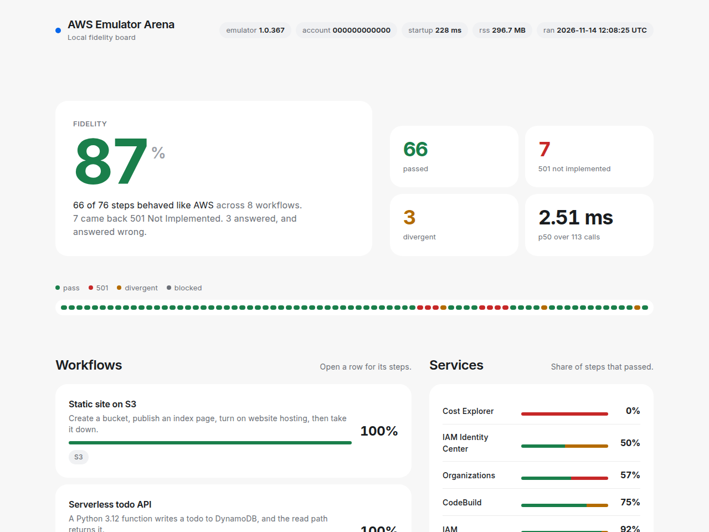

# AWS Emulator Arena

The [AWS Emulator](https://docs.aws.amazon.com/emulator/) runs the AWS APIs on your laptop. Arena runs the workflows a team would actually ship (a todo API, a static site, a queue worker, a CloudFormation stack, an account audit, a cost report, a pipeline, an IAM review) and publishes what happened.

[](https://github.com/leeclarkuk/aws-emulator-arena/actions/workflows/arena.yml)
[](LICENSE)
[](https://leeclarkuk.github.io/aws-emulator-arena/)
[](https://github.com/aws/aws-emulator/releases)

Each step lands in one of three piles: it behaved like AWS, the emulator returned 501 Not Implemented, or it answered and the answer was wrong. Latency is recorded per SDK call. An hourly GitHub Actions run installs the current emulator, appends a point to `scoreboard/history.json` when results change, and publishes the board.



## Latest measured run

The fidelity percentage, the passes, the 501s, and the divergences are on the [live board](https://leeclarkuk.github.io/aws-emulator-arena/) and in [`scoreboard/latest.json`](scoreboard/latest.json). The hourly job publishes the board on every run. It writes a new `scoreboard/latest.json` when the emulator version, the emulator commit, or the outcomes change.

- Workflows that pass cleanly: the static site, the serverless todo (the function really writes the item), the SQS to Lambda to DynamoDB pipeline (the order shows up in the table), and the CloudFormation stack (deleting the stack deletes the bucket).
- 501 Not Implemented: Organizations `ListAccounts`, `DescribeAccount`, `ListChildren`. Cost Explorer `GetCostAndUsage`, `GetDimensionValues`, `GetCostForecast`, `GetTags`. Budgets and an S3 cost export still work.
- Divergences: CodeBuild reports `SUCCEEDED` with `logs=None` and a BUILD phase of 0 seconds, so the buildspec did not run. The only Identity Center instance rejects `CreatePermissionSet` (`ValidationException`: not supported for account instances). `SimulatePrincipalPolicy` says `implicitDeny` for the built-in `user/emulator` principal, and that same key lists buckets anyway. An explicit deny on that user is enforced, and so are denies for users the scenario creates.

## Quickstart

Linux x86_64 or arm64, Python 3.10+, and the ability to install a deb package:

```bash
make arena
make serve
```

`make arena` installs the emulator if it is missing, checks the AWS package signature, starts it on `127.0.0.1:9297` with telemetry off, and writes `site/`. Open http://127.0.0.1:8765.

`scripts/run.sh` leaves an emulator that is already installed, including an older one. Run `make install-emulator` when you want the local run to use the latest package. It downloads the current deb, checks the signature, and installs it.

On a Mac or Windows machine, build the image (it installs the emulator) and run the same entrypoint:

```bash
docker build -t aws-emulator-arena .
docker run --rm \
  -v "$PWD/site:/arena/site" \
  -v "$PWD/scoreboard:/arena/scoreboard" \
  aws-emulator-arena
```

Run one workflow while you are writing it:

```bash
make arena ARGS="--only static-site"
```

## How a run is scored

```text
scenario file  ->  boto3, loopback only  ->  scoreboard/latest.json
                                              scoreboard/history.json
                                              site/index.html
```

Fidelity is the share of steps that passed:

```text
pass / (pass + 501 + divergent)
```

A blocked step never reached the emulator, because an earlier step did not produce what it needed. It is shown and left out of the percentage.

| Outcome | Meaning |
| --- | --- |
| pass | The call matched the assertion. An expected `AccessDenied` counts. |
| 501 | HTTP 501, or error code `NotImplemented`. |
| divergent | Any other error, or a success that failed the assertion. |
| blocked | Missing state from an earlier step. |

The runner will not start unless all of these are true:

- `AWS_ENDPOINT_URL` is HTTPS on `127.0.0.1`, `localhost`, or `::1`
- no ambient access key, session token, profile, or web-identity token is set
- the credentials file and CA bundle are the ones the emulator wrote under `~/.aws/emulator/<port>/`
- the access key starts with `EMULATOR`
- `GetCallerIdentity` returns account `000000000000`

There is no path in this repo that talks to AWS.

## The workflows

| Scenario | What it does |
| --- | --- |
| `static-site` | Bucket, index page, website hosting, then delete it. |
| `serverless-todo` | A Python 3.12 function writes a todo and DynamoDB reads it back. |
| `event-pipeline` | SQS message, event source mapping, Lambda worker, item lands in DynamoDB. |
| `cloudformation-stack` | A template creates a bucket and a queue. Deleting the stack deletes the bucket. |
| `platform-inventory` | IAM users, identity store, OUs, the account list, a permission set. |
| `finops-cost-report` | A budget, a cost export in S3, then Cost Explorer. |
| `cicd-control-plane` | CodeBuild and a CodePipeline whose source is an S3 object. |
| `iam-guardrails` | Implicit deny, explicit deny, allow, a bucket policy, and the built-in principal. |

## Add a scenario in five minutes

Create `arena/scenarios/hello_bucket.py`:

```python
from arena.scenario import Scenario

scenario = Scenario(
    slug="hello-bucket",
    title="Hello bucket",
    summary="Create a bucket and read back the object you put in it.",
    services=["s3"],
)

@scenario.step("Create a bucket", service="s3", operation="CreateBucket")
def create_bucket(aws, state):
    name = state.rid("hello")
    aws.client("s3").create_bucket(Bucket=name)
    state["bucket"] = name

@scenario.step("Round-trip an object", service="s3", operation="GetObject")
def round_trip(aws, state):
    state.need("bucket")
    s3 = aws.client("s3")
    s3.put_object(Bucket=state["bucket"], Key="hello.txt", Body=b"hello")
    body = s3.get_object(Bucket=state["bucket"], Key="hello.txt")["Body"].read()
    if body != b"hello":
        raise AssertionError(f"body is {body!r}")
```

Register it in `arena/scenarios/__init__.py`, then:

```bash
make test
make arena ARGS="--only hello-bucket"
```

`state.rid()` keeps names unique. Raise `AssertionError` when the bytes are wrong. Use `expect=error("AccessDenied")` from `arena.scenario` when AWS should say no. Do not catch a 501 and mark it successful. The longer version, including how the four outcomes are decided, is in [CONTRIBUTING.md](CONTRIBUTING.md).

Open a [scenario proposal](https://github.com/leeclarkuk/aws-emulator-arena/issues/new?template=new-scenario.yml) if you would rather discuss the workflow before writing it, or an [emulator gap](https://github.com/leeclarkuk/aws-emulator-arena/issues/new?template=emulator-gap.yml) when a step comes back 501 or divergent.

## The board, every hour

[`.github/workflows/arena.yml`](.github/workflows/arena.yml) installs the latest signed package, runs the arena on every pull request, and on a push to `main`. A schedule (`7 * * * *` UTC) does the same so a new emulator release shows up as the next point on the chart. On `main` the workflow commits `scoreboard/latest.json` and `scoreboard/history.json` only when the emulator version or commit, a step outcome, or the summary counts changed; timing-only noise is skipped. Every scheduled run still deploys `site/` with `actions/deploy-pages` so the board's ran timestamp stays fresh.

The scoreboard is a static page. It has no backend. The data is inlined, so it works at a project-pages URL.

One manual step before the live URL exists: in the repository settings, open Pages and set the source to GitHub Actions. The first deploy also needs the default `GITHUB_TOKEN` to be allowed to write to `main` (Settings, Actions, General, Workflow permissions, Read and write). Branch protection that blocks the `github-actions` bot will keep the chart from gaining points; the Pages deploy in that same job will not run either.

## Layout

```text
arena/scenarios/     one file per workflow
arena/runner.py      runs them and writes the scoreboard
scoreboard/          latest.json and history.json, committed
web/                 the page the runner fills in
site/                generated, gitignored, deployed to Pages
scripts/run.sh       emulator lifecycle and the only supported entrypoint
```

## License

[MIT](LICENSE). AWS Emulator is a separate project: [docs](https://docs.aws.amazon.com/emulator/), [source](https://github.com/aws/aws-emulator), [announcement](https://aws.amazon.com/blogs/aws/test-your-applications-against-aws-locally-with-aws-emulator/).
